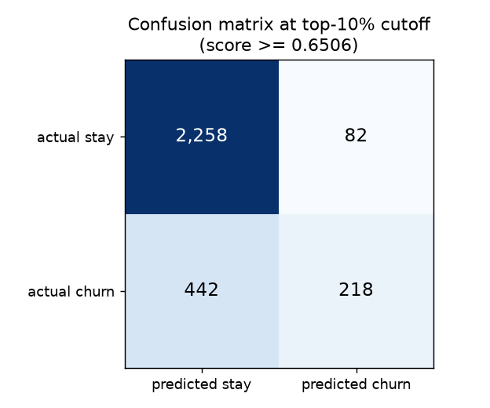
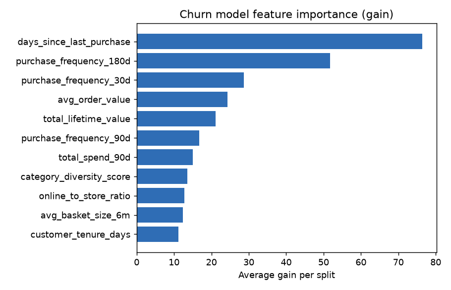

# Lab 3 Evaluation Report: Churn Model

**Model:** XGBoost **3.2.0** (trained locally), max_depth 3, eta 0.05, best round 153
**Data:** Feature Store offline store via Athena (query ID in `lab3-evidence/train-final.log`)
**Test set:** 3,000 customers (30% stratified split of 9,999), 22% churners
**Registry:** `northstar-churn-models`, status **PendingManualApproval**

## Results

| Metric                                         | Value                | Threshold      |
| ---------------------------------------------- | -------------------- | -------------- |
| AUC-ROC                                        | **0.7840**           | none           |
| Precision @ top 10%                            | **0.7267**           | >= 0.50        |
| Recall @ top 10%                               | **0.3303**           | >= 0.25        |
| Recency-only baseline AUC                      | 0.7223               |                |
| AUC lift over baseline                         | **+0.0617**          |                |
| Lift 95% CI (2,000 paired bootstrap resamples) | **[0.0416, 0.0795]** | must exclude 0 |

The baseline is XGBoost on `days_since_last_purchase` only, trained and tested on the same rows.

**Class imbalance:** `scale_pos_weight` = negatives / positives in the training split = 5,459 / 1,540 = **3.545**, computed from the data rather than hardcoded.

## Experiments (MLflow, experiment `northstar-churn`)

| Run                           | What changed                | AUC                 |
| ----------------------------- | --------------------------- | ------------------- |
| xgb-d6-eta0.2                 | starting settings           | 0.7771              |
| **xgb-d3-eta0.05**            | shallower, slower trees     | **0.7840** (chosen) |
| xgb-d4-eta0.1-mcw10           | middle depth, larger leaves | 0.7828              |
| xgb-d6-eta0.2-with-risk-score | added `churn_risk_score`    | 0.7730              |

**With vs without `churn_risk_score`** (same settings): 0.7771 without, 0.7730 with. It is a recency rule, so it repeats `days_since_last_purchase` and lowered AUC. The final model excludes it. All runs: `lab3-evidence/mlflow-runs.csv`.

## Confusion matrix (top 10% of scores, score >= 0.6506)

## Feature importance

## Slice evaluation by loyalty tier

| Tier     | n     | Churners | AUC       | Recall @10% |
| -------- | ----- | -------- | --------- | ----------- |
| Bronze   | 1,071 | 361      | 0.759     | 0.454       |
| Silver   | 1,139 | 226      | **0.714** | 0.190       |
| Gold     | 483   | 52       | 0.753     | 0.115       |
| Platinum | 307   | 21       | 0.877     | 0.238       |

- **Weakest tier: Silver** (lowest AUC, 0.714).
- **Platinum is too small to conclude from:** only 21 churners in the test set.

> Silver is the weakest because the model has a hard time determining whether Silver members are more likely to leave or stay. The model mostly relies on recency, but loyalty tiers are based on spending. This means the tier might be hard to score when both the churners and the not churners are similar in recency.
